# 电商评论证据 Agent · ECom Review Intelligence

  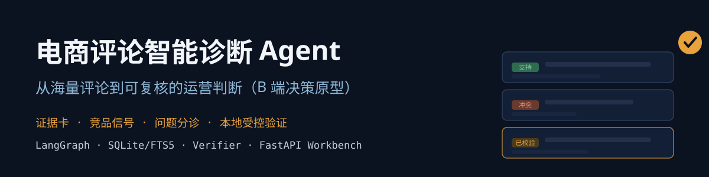

把一个商品的评论变成**能点回原文**的结论，而不是一段无法溯源的总结。

运营每天要回答这种问题：老板问「噪音到底是不是普遍问题」，凭感觉说不清。回答它只有两条路：人工翻 766 条评论——没人真会翻完，最后靠最显眼的那几条差评定印象；或者丢给聊天机器人总结——得到的引用没法核对。这个工具给的是第三条路：

- **命中多少**：这款制冰机 4,241 条评论里，「运行噪音」匹配 766 条（18%）。
- **抽 5 条核对**：按星级分层抽样，每条给出支持 / 反对 / 冲突 / 信息不足的判定，可以逐字对照原文。
- **每句有出处**：引用必须是评论原文里的逐字子串，对不上就整段丢弃；数字逐个回统计口径重算。
- **能带走**：把这 766 条导成 CSV（16 列，含三列人工标注位），不调用模型、不需要密钥。

下载 42 MB 的 exe 双击就能跑，不填 key 也能跑完诊断；填自己的 DeepSeek key 才启用「AI 深入分析」和对话助手。

先看 30 秒（四帧都是本机全量库的真实界面，目录 244 个商品）：

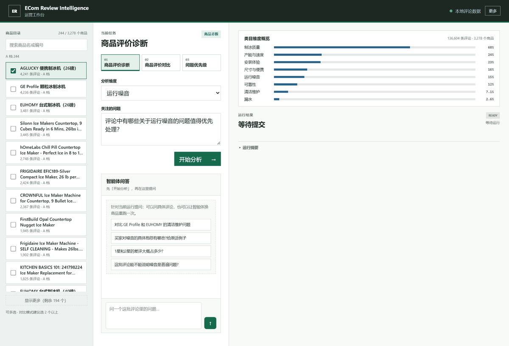

## 目录

- [一分钟看懂](#一分钟看懂) · [系统架构](#系统架构) · [核心特性](#核心特性) · [界面](#界面)
- [快速开始](#快速开始) · [想用全量数据（可选）](#想用全量数据可选) · [三条工作流](#三条工作流)
- [为什么不直接用 ChatGPT](#为什么不直接把评论丢给-chatgpt) · [为什么可信](#为什么可信) · [被实验否掉的方案](#被实验否掉的方案) · [边界与已知限制](#边界与已知限制)

## 一分钟看懂

| 关键数字 | 实测 |
| --- | --- |
| 数据底座 | 3,278 款商品 / 136,604 条评论的本地证据库；评论文本不出本机 |
| 一次诊断 | 服务端约 0.1 秒（演示库两次实测 123 / 142 ms），本地跑、不联网 |
| 引用可信 | 每句引文必须是评论原文的逐字子串，一个字不对整段丢弃 |
| 模型评测 | 15 个冻结案例 × 2 = 30 个真实调用结果：26 通过、4 次预期降级、0 越权 / 注入成功 |
| 测试 | 604 项 pytest 全绿（本仓库实测，CI 上同样跑一遍） |
| 上手 | 42 MB exe 双击即跑；不填 key 也能跑完完整量化流程 |

## 系统架构

  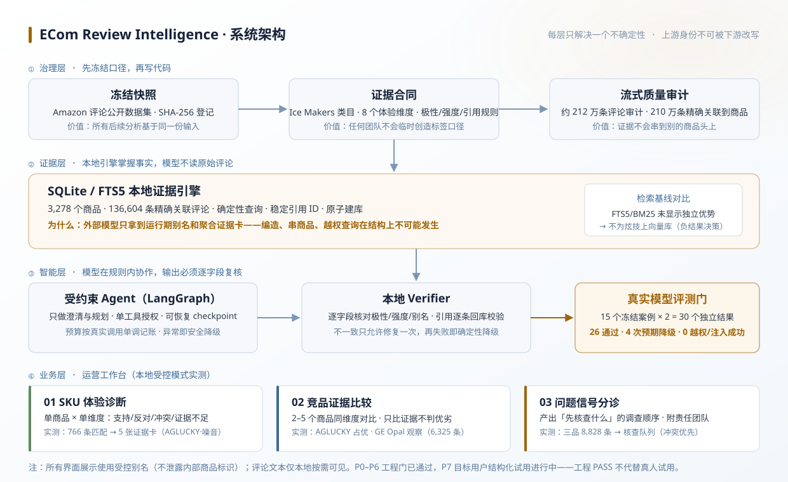

四层各挡一类不确定性：**治理层**先冻结口径（快照、证据合同、流式审计），**证据层**让本地引擎掌握全部事实——外部模型只拿运行期别名和聚合证据卡，编造、串商品、越权查询在结构上不可能发生；**智能层**的每一步输出都要过本地 Verifier 逐字段复核、不过就确定性降级；**业务层**是本地工作台。上游身份不可被下游改写。

> 从选类目、建库、约束设计到桌面打包，整条链路由一个人完成；两个「看起来更聪明」的方案被实验否掉，见[被实验否掉的方案](#被实验否掉的方案)。

## 核心特性

- 🎯 **三套工作流**：单品诊断 / 商品对比（2–5 台同维度）/ 问题分诊（先查什么、谁负责）
- 🔍 **逐字可溯源**：每条结论抽 5 条样本，可点开原文逐字核对
- 🧮 **数字可复算**：所有计数由本地代码现场重算，不预打标签、不经模型
- 🤖 **受约束 Agent**：模型只读聚合卡与最多 5 条抽样原文；引用、引文、数字、结构四道校验，不过整段丢弃
- 📤 **一键带走**：当前运行命中的全部评论导出 CSV（16 列，含三列人工标注位），不调模型、不要密钥
- 🔌 **MCP 工具服务器**：五个确定性证据工具按 Model Context Protocol 标准暴露，Claude Desktop 等客户端即插即用；评论原文、ASIN、路径不出本机（零新增依赖，见 [docs/mcp-server.md](docs/mcp-server.md)）
- 🖥️ **双击即用**：42 MB Windows exe；克隆仓库也行——自带 3 商品演示库

## 界面

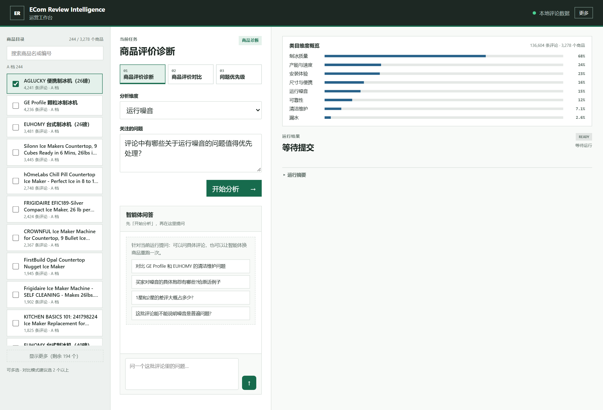

一次「运行噪音」诊断：左栏商品目录（A 档 244 个，全库 3,278 个），中间选方面和要回答的问题，右栏出结果。右上角的「类目维度概览」给出全库参照——有了「全类目噪音只占 15%」这一层底，才知道单商品抽到的抱怨算不算突出。

对话里问一句，模型不会「直接读库」：先申请读某张证据卡、再查统计，本地执行完把结果回传，最后才提交回答。每一次工具调用单独列出参数摘要和耗时：

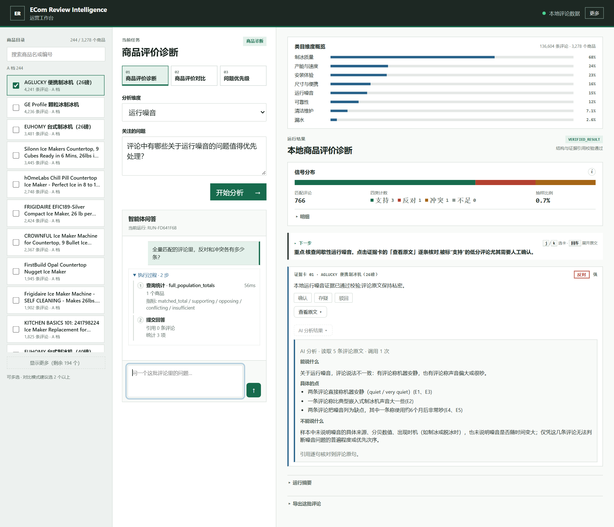

「AI 深入分析」的实测输出（评论原文按数据边界不贴，只保留归纳与编号）：

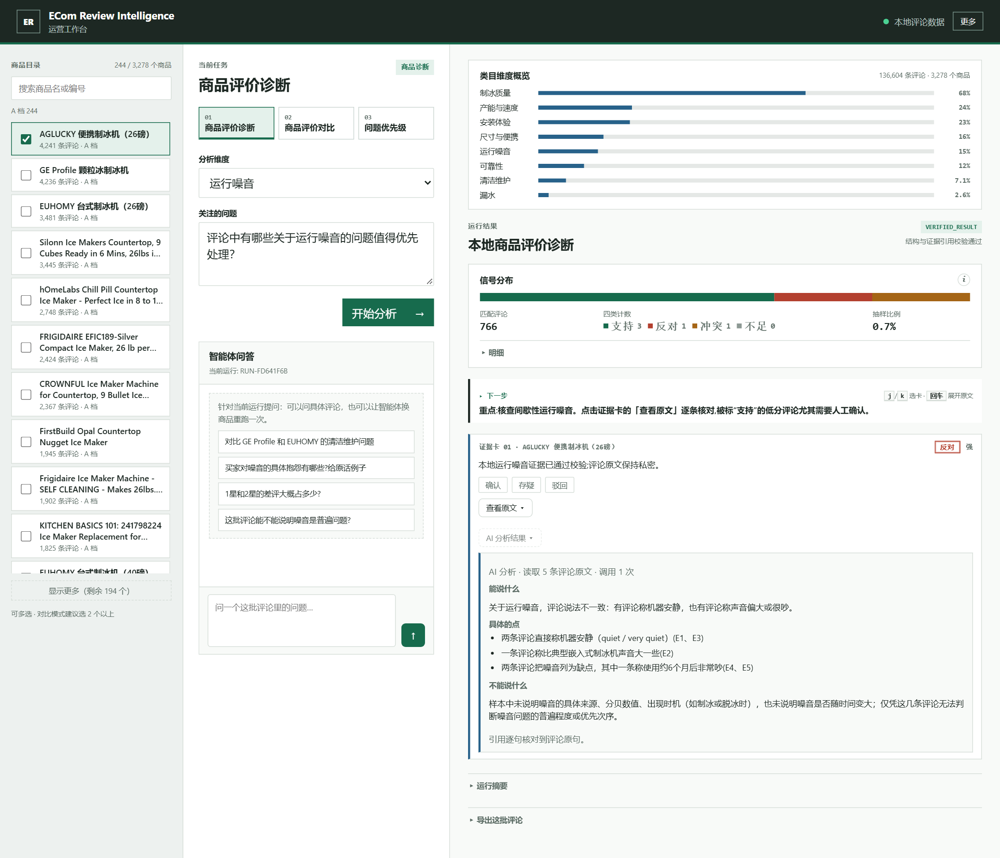

更多界面：模型设置 / 导出 CSV / 移动端

 

「模型设置」里填自己的 DeepSeek key 才启用两条模型步骤；默认勾选「在这台电脑上记住」存在本机浏览器，不勾则只存当前标签页。key 随请求传给本地服务，不落盘、不写日志：

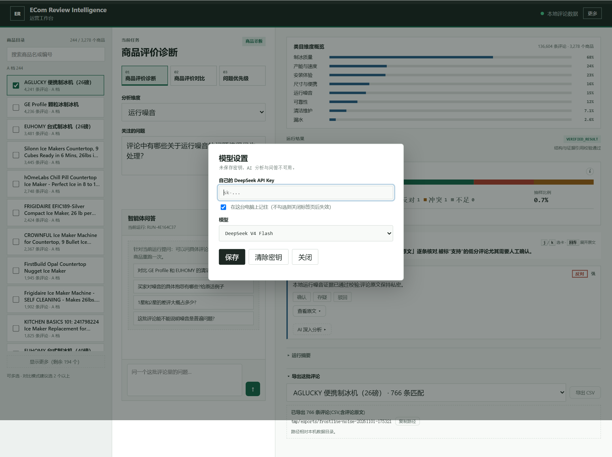

诊断跑完可把该商品当前方面的全部匹配评论导成 CSV（766 行、16 列，含「参与本次判断」标记与三列人工标注位），不调用模型、不需要密钥；复制按钮给的是相对本机数据目录的路径：

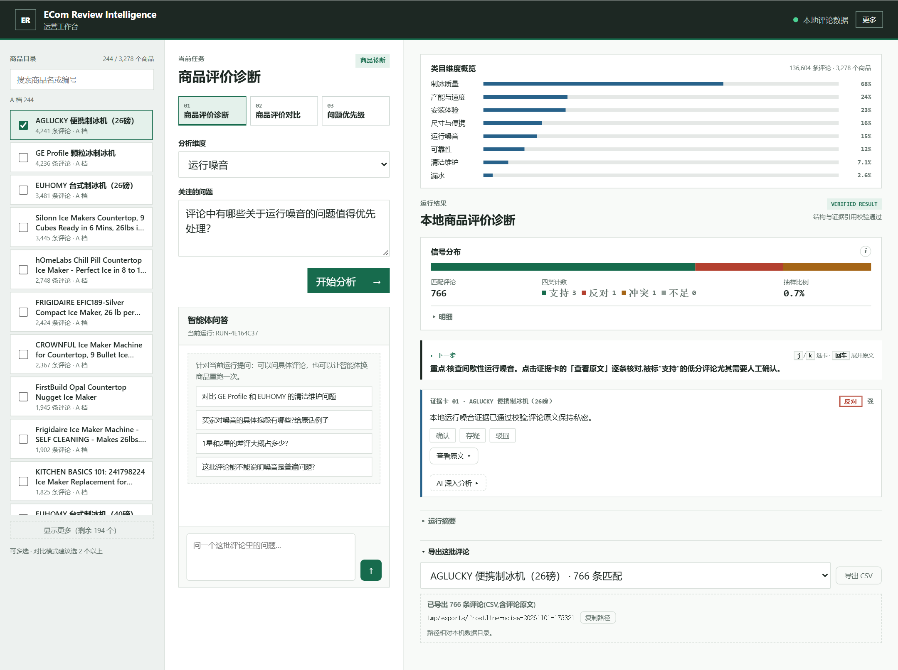

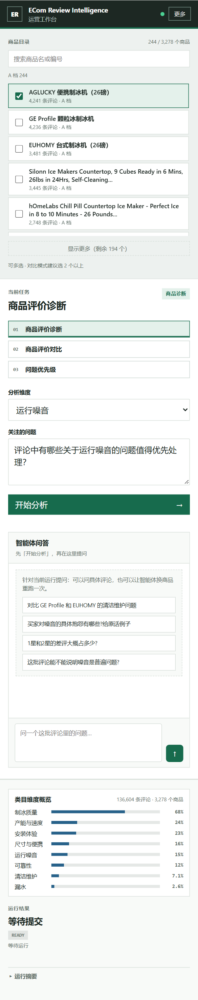

界面图用真实 Chrome 截自本机全量库（244 个 A 档商品 / 3,278 个商品 / 136,604 条评论），由 `scripts/capture_public_screenshots.cjs` 驱动，每张图先过路径 / ASIN / 哈希文本护栏再落盘；仓库自带的演示库只有 3 个商品，跑起来时目录会短一些、口径不变。对话图保留了问题与执行轨迹、裁掉了回答区，解读图只留归纳与编号，避免把评论原文带进公开仓库。

<b>v0.3.0 改了什么</b>

- 目录从 3 个商品扩到 244 个「评论数 ≥100」的 A 档商品（覆盖全部评论的 74.3%），同类目商品可以直接换着查；
- 新增类目基线：八个冻结方面在全库 136,604 条评论里各占多少，单商品的 5 条样本不再悬空；
- 布局改成「商品目录 / 任务 / 结果」三栏，原来的「覆盖率」改名「抽样比例」（口径不变：样本数 ÷ 匹配数）；
- 两条模型步骤不再绑死 DeepSeek：设 `ECOM_MODEL_PROVIDER=ollama` 就能指向任意 OpenAI 兼容端点（包括本机 checkpoint），本机小模型的实测结论写在 `docs/engineering-readme.md`。

仓库自带的演示库仍只带 3 个商品，244 个只在本机全量库生效。

## 快速开始

| 方式 | 适合 | 怎么用 |
| --- | --- | --- |
| 桌面 exe | 零环境，双击即用 | 下载 [Release](https://github.com/TheSKY-3/ecom-review-intelligence/releases/latest) 里的 `EComReviewIntelligence.exe`（42 MB，内置演示子集） |
| 容器 | 有 Docker 的人 | `docker compose up --build demo` → `http://127.0.0.1:8000` |
| 源码 | 想读代码、跑测试 | `pip install -e ".[dev]"`，然后 `pytest` 或 `scripts/serve_demo.py --mode bundled` |
| MCP 客户端 | 想在 Claude Desktop 里直接调用证据工具 | 配置一行命令，见下 |

接入 Claude Desktop（MCP）

 

在 `claude_desktop_config.json`（开发者 → 编辑配置）里加：

~~~json
"ecom-review-intelligence": {
  "command": "<你的 python>",
  "args": ["<项目根>/scripts/run_mcp_server.py", "--project-root", "<项目根>"]
}
~~~

客户端拿到的是 `list_products` / `diagnose_product` / `compare_products` / `triage_issues` / `category_baseline` 五个工具——只有计数、商品标题与本地编号、维度名；评论文本、证据 ID、ASIN、路径不离开你的机器，这条边界有测试盯着。实现与验证记录见 [docs/mcp-server.md](docs/mcp-server.md)。

下面是在 ZCode 客户端里真实调用的实测截图（会话截图，已裁去窗口其余部分）：问一句「用 MCP 查一下 frostline 的运行噪音」，客户端按协议调起本机服务器：

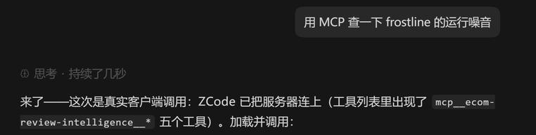

返回的只有口径和数字，与工作台同屏数字逐位一致：

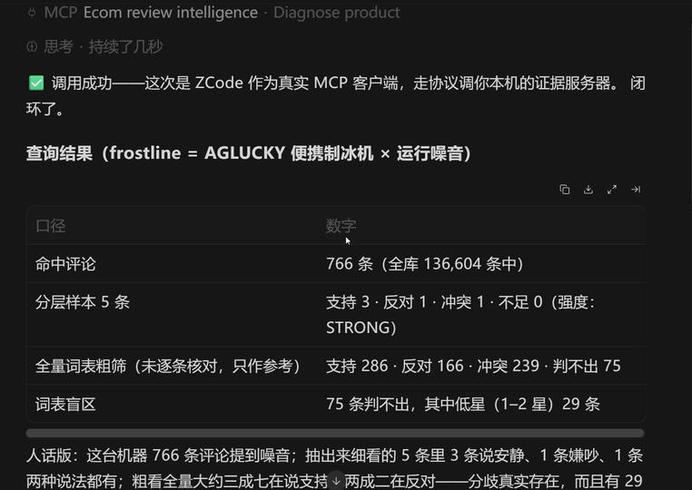

仓库自带 `data/public/ice_makers_public.sqlite`：3 个商品、11,958 条真实评论、10.9 MB，所以**克隆即可运行**，不需要原始数据集。

跑一次的体验：

| | 实测 |
| --- | --- |
| 一次诊断 | 服务端约 0.1 秒，本地跑、不联网 |
| 需要 key 吗 | 不需要；「AI 深入分析」和对话助手才要 |
| 拿到什么 | 5 条可点回原文的抽样凭证 + 信号分布 + 命中评论 CSV（16 列，含三列人工标注位） |
| 导出在哪 | 本机数据目录下 `tmp/exports/<商品>-<时间>/`，界面只显示相对路径 |

## 想用全量数据（可选）

上面截图来自本机全量库。仓库只带 3 商品演示库，全量库需要你自己从原始数据构建一次——数据不随仓库分发：

1. 从 Amazon Reviews 2023 下载两个文件，放进 `data/raw/`：
   - `Appliances.jsonl.gz`（约 270 MB）：<https://mcauleylab.ucsd.edu/public_datasets/data/amazon_2023/raw/review_categories/Appliances.jsonl.gz>
   - `meta_Appliances.jsonl.gz`（约 66 MB）：<https://mcauleylab.ucsd.edu/public_datasets/data/amazon_2023/raw/meta_categories/meta_Appliances.jsonl.gz>
2. 注册并校验这两个文件（只读本地文件，不联网也行）：
   ~~~powershell
   python scripts/run_register_existing.py --project-root .
   ~~~
3. 用仓库里冻结的 P2 范围与 P3 契约物化证据库：
   ~~~powershell
   python scripts/run_phase4_build.py --project-root .
   ~~~
   产物是 `data/processed/ice_makers_evidence.sqlite`：117,563,392 字节、contract `b93053ce…`，与本仓库作者本机那份逐字节一致（2026-10-31 在干净 checkout 上实测，构建后工作台返回 244 / 3,278 个商品）。
4. 用全量库启动工作台：
   ~~~powershell
   python scripts/run_phase7_workbench.py --mode local --acknowledge-local-data --project-root .
   ~~~

第 3 步刻意复用仓库里冻结的 P2/P3 工件：重建的是数据和证据库，不是契约。如果你要改方面词表或契约，就得重跑 `run_phase2_audit.py --selected-category "Ice Makers"` 和 `run_phase3_contract.py`——那会生成新的 contract id（重跑带时间戳，同样的输入也不会字节复现），评测与工作台的冻结配置都要一起重签。

## 三条工作流（本地真实数据实测）

| 工作流 | 做什么 | 实测 | 拿到之后 |
| --- | --- | --- | --- |
| 01 体验诊断 | 单商品 × 单维度：支持/反对/冲突/信息不足 | 「运行噪音」匹配 766 条 → 5 张已校验证据卡 | 给「这条差评要不要升级」一条能点回原文的线索；「判不出」的 75 条（其中低星 29 条）转人工复核 |
| 02 证据比较 | 2–5 个商品同维度对比，只陈述方向 | AGLUCKY vs GE Profile「制冰质量」→「A 占优·强 / B 观察·强」 | 选主推、给供应商提改进点，两边说法都能点回原文，不再各说各话 |
| 03 问题分诊 | 产出"先查什么"的顺序与责任团队 | 三款商品 → 核查队列，冲突证据显式标出 | 「先查漏水」从个人直觉变成可以交给质量团队的核查顺序 |

样本是小凭证、不是统计结论——「拿到之后」给的是线索和核查顺序，不是替代判断的结论。

三种工作流跑完都能导出当前运行的命中评论为 CSV，方便人工标注复核（见上方「更多界面」里的导出示例）。

## 为什么不直接把评论丢给 ChatGPT？

可以，但你会得到一段流利的总结，和无法核对的引用。这个工具的差别在三个「不」：

- 模型**不**接触原始评论库：它只拿运行期别名、聚合证据卡和最多 5 条抽样原文；
- 引用**不**由模型说了算：每句引文逐字回原文比对，必须是该评论的子串，一个字不对整段丢弃；
- 数字**不**经模型的手：所有计数由本地代码现场重算，不一致就确定性降级。

总结可以问聊天机器人要；要拿去汇报、排核查顺序的结论，得能点回原文。

## 为什么可信

| 担心 | 怎么防 |
| --- | --- |
| 模型编造证据 | 模型只能看受控的聚合卡和最多 5 条抽样原文，不能自己查库；统计数字由本地代码算 |
| 引文被改写 | 每条引用逐字回原文比对，必须是该评论的子串；一个字不对整段丢弃 |
| 数字对不上 | 每个数字回统计口径重新算；不一致只允许修一次，再失败就降级成确定性输出 |
| 串了别的商品 | 评论按 ASIN 精确关联，跨商品不会混进来 |

四道校验、证据合同、Verifier 这些实现细节见 [docs/engineering-readme.md](docs/engineering-readme.md)。

## 被实验否掉的方案

「让模型判断证据够不够」被两轮实验否掉：

| 方案 | 第一批人工标注 | 第二批 | 结论 |
| --- | --- | --- | --- |
| 手写计数规则 | 0.65 | 0.35 | 换批次就崩，学到的不是判断而是批次特征 |
| 模型探针（宽松提示词） | 0.55 | 0.80 | 37.5% 假阳性 |

所以模型只做「把评论读成结构」，够不够仍由确定性分档决定。记录见 [docs/decisions/phase-7-model-role.md](docs/decisions/phase-7-model-role.md)。

检索侧同样是负结果：

| 方案 | recall@5 | 案例命中率 |
| --- | --- | --- |
| FTS5 / BM25 | 0.533 | 0.870 |
| 词法基线 | 1.0 | 1.0 |

所以不为炫技上向量库。但要说清局限：「期望证据」本身就是从词法基线推出来的，这个对比只能当回归检查，不能当独立效果证明（工件里写明了这一点）。

## 边界与已知限制

- **什么时候不该用它**：要实时数据、销量 / 价格关联、缺陷率或因果结论时——词表口径的证据信号不是商业影响，这是设计边界，不是待修的缺陷。
- **AI 步骤的可用性**：评测里 15 次真实调用 14 次可用，唯一失败是「判为相关却没引用」，重试即通过；另有一次稳定失败（模型把编号 E1–E5 写成 R1–R5）定位后修在提示词层。AI 只是可选项，关掉不影响量化流程。
- **演示库不是分发通道**：仓库自带 3 商品 / 11,958 条评论（10.9 MB），完整类目库约 118 MB 不在仓库里，构建步骤见「想用全量数据」；导出只针对当前运行命中的评论，不做全库批量导出。
- **门是可复算的流程，不是可重放的语料**：工程门记录在 `artifacts/`；冻结评测案例集不随仓库发布（`artifacts/evals/` 未发布），所以任何人都能按流程复算，但没法拿同一套语料重放。
- **数据来源**：数据集来自 Amazon Reviews 2023，条款与展示边界见 [docs/data-use-and-publication.md](docs/data-use-and-publication.md)。

## License

代码 MIT。数据集遵其来源条款。
