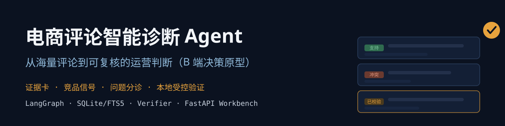
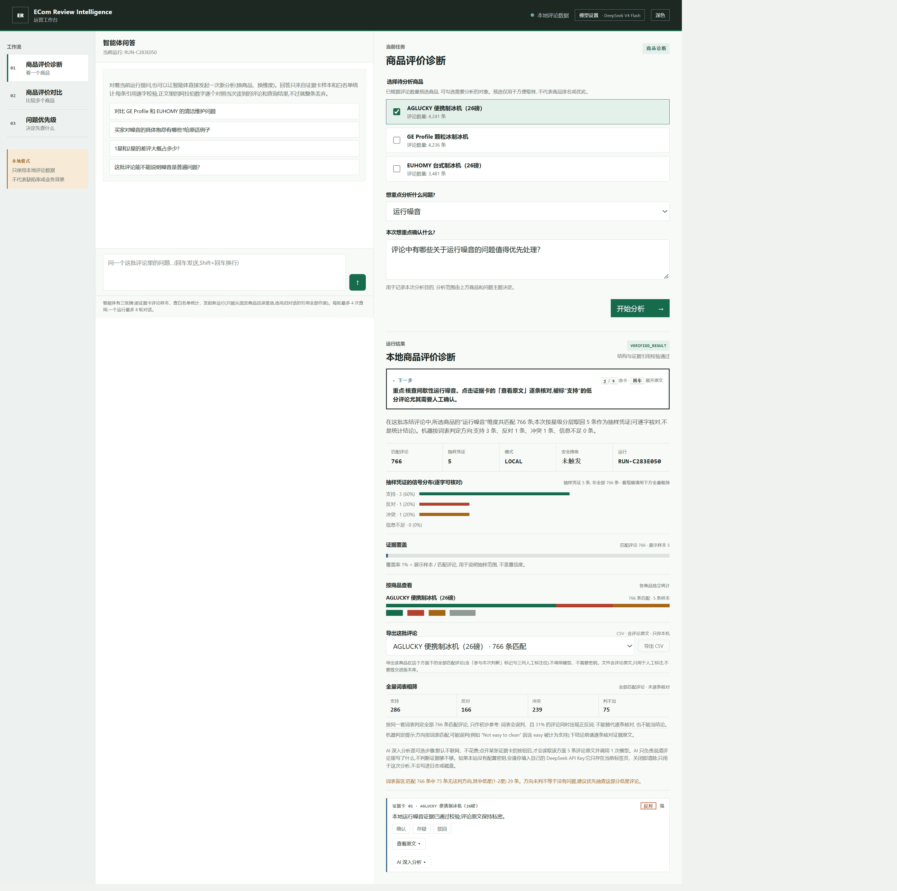
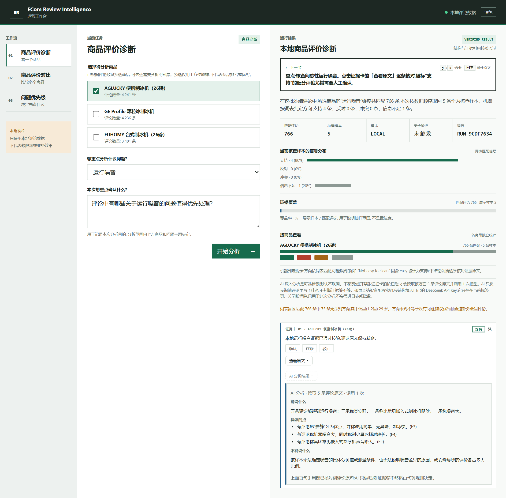
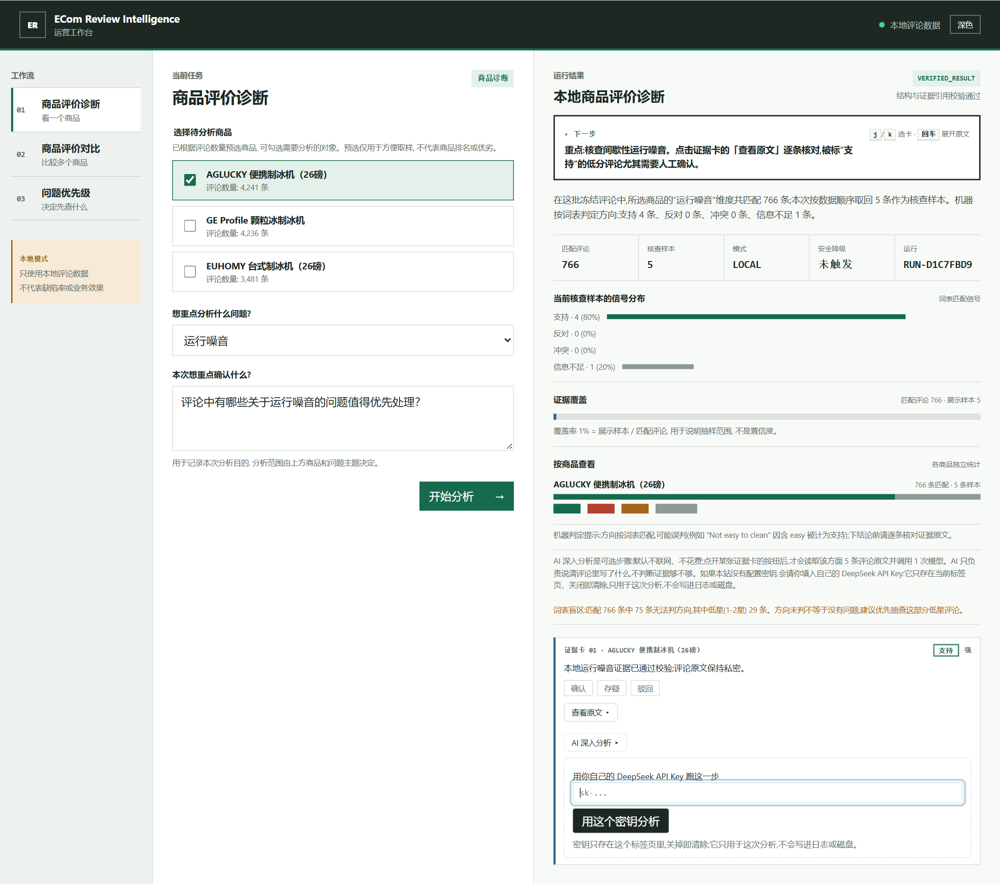

# 电商评论证据 Agent · ECom Review Intelligence

  

把海量商品评论整理成**可回查、可复核**的运营证据，而不是一段无法溯源的总结。
受约束 Agent + 本地证据引擎 + 逐字段校验：模型只拿运行期别名与聚合证据卡，不读原始评论、不能任意查询，写不出卡片里没有的事实。

## 界面

一次「运行噪音」诊断：匹配 766 条、取 5 条核查样本、四类信号分布，以及"覆盖率 1% 不是置信度"的提示。

点开「AI 深入分析」：读取该维度 5 条评论原文、调用 1 次模型，产出「能说什么 / 具体的点 / 读作无关的评论 / 不能说什么」。这一步默认不联网、不花钱。

如果部署方没有配置密钥，页面会请访问者填自己的 DeepSeek key——只存在当前标签页，关闭即清：

三张图都由 `scripts/capture_workbench_screenshots.cjs` 用真实 Chrome 截取；脚本保存前会拒绝含路径、商品编号或哈希形状的页面文本。

## 为什么可信

| 设计 | 防什么错 | 怎么做 |
| --- | --- | --- |
| 证据合同先冻结 | 开发者或模型临时造标签 | 类目、8 个体验维度、极性/强度/引用规则在检索与 Agent 之前冻结 |
| 本地证据引擎 | 编造证据、把别的商品的评论算到当前商品头上 | 92 个类目体检（73 够格）→ 选定制冰机：3,278 商品 / 136,604 条评论精确关联；模型只拿别名与聚合卡 |
| 逐字段 Verifier | 模型改写证据卡的极性与强度 | 引用逐条回库校验；不一致只允许修复一次，再失败即确定性降级 |
| 四道引用校验（AI 步骤） | 模型删负面评论、拿无关评论凑数、伪造引文 | 每条评论必须有自己的判定；判为相关的必须至少被引用一次；被引用的必须判为相关；引文必须是该评论的逐字子串。任一不过整段丢弃 |

## 三种打开方式

| 方式 | 适合 | 怎么用 |
| --- | --- | --- |
| 桌面 exe | 零环境，双击即用 | 下载 Release 里的 `EComReviewIntelligence.exe`（42 MB，内置演示子集） |
| 容器 | 有 Docker 的人 | `docker compose up --build demo` → `http://127.0.0.1:8000` |
| 源码 | 想读代码、跑测试 | `pip install -e ".[dev]"`，然后 `pytest` 或 `scripts/serve_demo.py --mode bundled` |

仓库自带 `data/public/ice_makers_public.sqlite`：3 个商品、11,958 条真实评论、10.9 MB，所以**克隆即可运行**，不需要原始数据集。

## 三条工作流（本地真实数据实测）

| 工作流 | 做什么 | 实测 |
| --- | --- | --- |
| 01 体验诊断 | 单商品 × 单维度：支持/反对/冲突/信息不足 | 「运行噪音」匹配 766 条 → 5 张已校验证据卡 |
| 02 证据比较 | 2–5 个商品同维度对比，只陈述方向 | AGLUCKY vs GE Profile「制冰质量」→「A 占优·强 / B 观察·强」 |
| 03 问题分诊 | 产出"先查什么"的顺序与责任团队 | 三款商品 → 核查队列，冲突证据显式标出 |

## 一个负结果，写在这里

「证据够不够」这个问题被两轮实验否掉了：手写计数规则跨两批人工标注从 0.65 掉到 0.35；模型探针 0.55 / 0.80，宽松提示词有 37.5% 假阳性——换批次就崩，学到的不是判断而是批次特征。所以模型只做"把评论读成结构"，够不够仍由确定性分档决定。记录见 [docs/decisions/phase-7-model-role.md](docs/decisions/phase-7-model-role.md)。

检索侧同样是负结果：FTS5/BM25 在 27 个冻结案例上 recall@5 0.533、案例命中率 0.870，而词法基线是 1.0/1.0——但"期望证据"本身就是从词法基线推出的，所以这个对比只能当回归检查，不能当独立效果证明（工件里写明了这一点）。

## 边界（读之前请先看）

- **没有真人试用数据**：工程门通过不等于运营愿意用，P7 的三次真实试用尚未进行。
- AI 步骤 15 次真实调用 14 次可用，唯一失败是"判为相关却没引用"，重试即通过；一次稳定失败（模型把编号 E1–E5 改写成 R1–R5）定位后修在提示词层。
- 仓库自带的是固定 3 商品演示子集，不是数据分发通道：没有批量导出接口；完整类目库（165 MB）与原始 gzip 不在仓库中。
- 工程门记录在 `artifacts/`；冻结评测案例集本身不在仓库（`artifacts/evals/` 被忽略），所以门是"可复算的流程"而不是"可重放的语料"。
- 数据集来自 Amazon Reviews 2023，条款与展示边界的讨论见 [docs/data-use-and-publication.md](docs/data-use-and-publication.md)。

## License

代码 MIT。数据集遵其来源条款。
