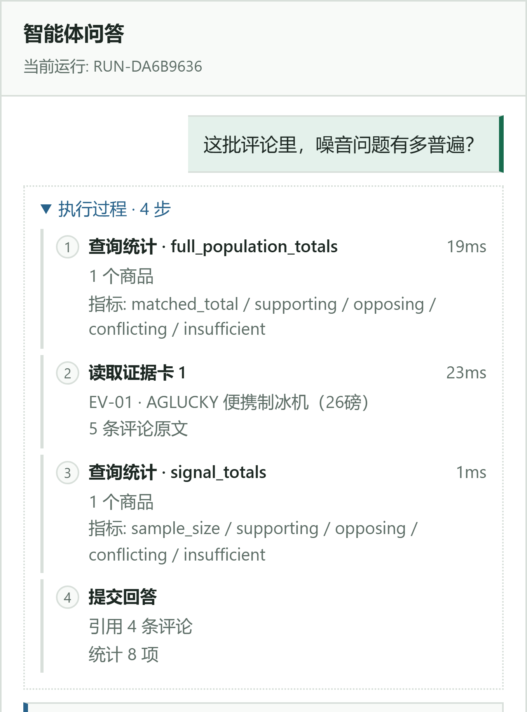
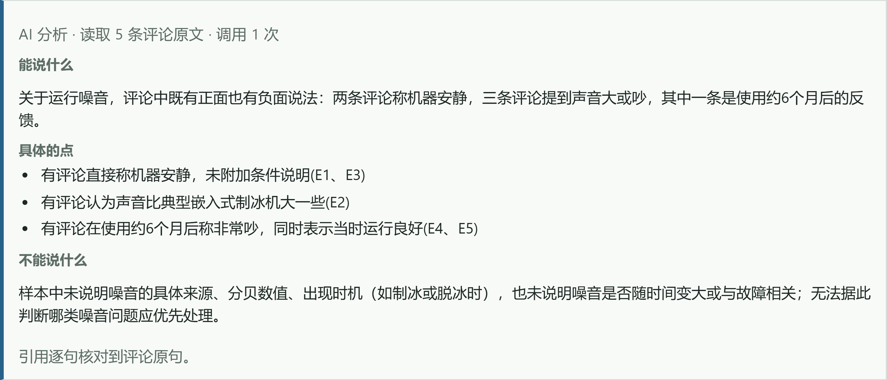
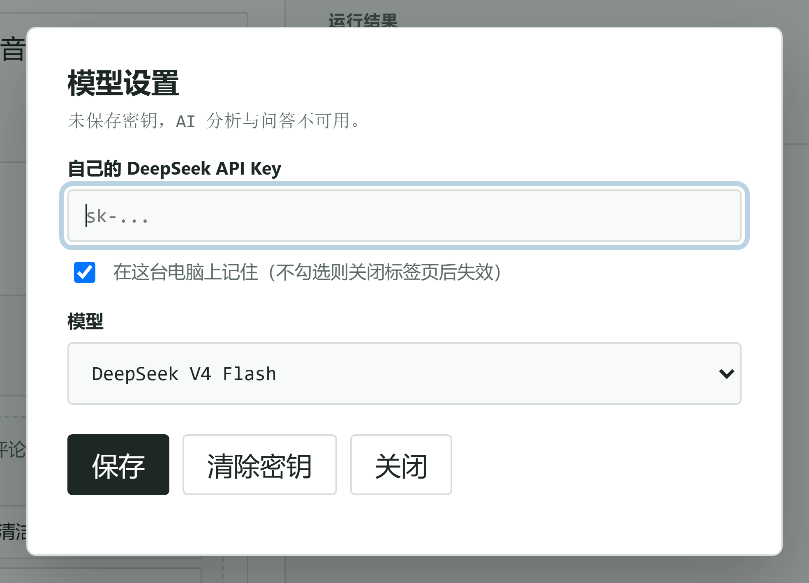
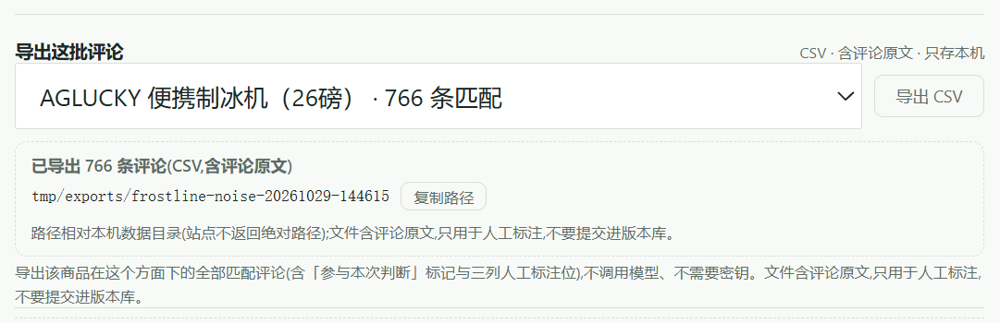

# 电商评论证据 Agent · ECom Review Intelligence

  

把一个商品的评论变成**能点回原文**的结论，而不是一段无法溯源的总结。

运营每天要回答这种问题：老板问「噪音到底是不是普遍问题」，凭感觉说不清。这个工具给的是：

- **命中多少**：这款制冰机 4,241 条评论里，「运行噪音」匹配 766 条（18%）。
- **抽 5 条核对**：按星级分层抽样，每条给出支持 / 反对 / 冲突 / 信息不足的判定，可以逐字对照原文。
- **每句有出处**：引用必须是评论原文里的逐字子串，对不上就整段丢弃；数字逐个回统计口径重算。
- **能带走**：把这 766 条导成 CSV（16 列，含三列人工标注位），不调用模型、不需要密钥。

下载 42 MB 的 exe 双击就能跑，不填 key 也能跑完诊断；填自己的 DeepSeek key 才启用「AI 深入分析」和对话助手。

## 界面

一次「运行噪音」诊断：4,241 条评论里匹配 766 条，按星级分层抽 5 条（支持 3 / 反对 1 / 冲突 1 / 信息不足 0），每张证据卡都能展开原文。下方的「全量词表粗筛」用同一套词表扫完全部 766 条（支持 286 / 反对 166 / 冲突 239 / 判不出 75），并写明「未逐条核对、不能当结论」。界面把 5/766≈0.65% 取整显示成「覆盖率 1%」——它只说明抽样范围，不是置信度。

对话里问一句，模型不会「直接读库」：它先申请读某张证据卡、再查统计，本地执行完把结果回传，最后才提交回答。每一次工具调用单独列出参数摘要和耗时：

输出长这样（下图是「AI 深入分析」的实测结果；评论原文按数据边界不贴，只保留归纳与编号）：

「模型设置」里填自己的 DeepSeek key 才能启用两条模型步骤；默认勾选「在这台电脑上记住」会存在本机浏览器里，不勾则只存当前标签页、关闭即忘。key 随请求传给本地服务，服务端不落盘、不写日志：

一次诊断跑完，右侧会出现「导出这批评论」：选商品、点「导出 CSV」，就把这个商品在当前方面下的全部匹配评论写成表格（766 行，16 列，含「参与本次判断」标记和三列人工标注位）。导出不调用模型、不需要密钥；复制按钮给的是相对本机数据目录的路径：

界面图用真实 Chrome 截自 `scripts/serve_demo.py --mode bundled` 的演示数据；对话图保留了问题与执行轨迹、裁掉了回答区，避免把评论原文带进公开仓库。

> **2026-10-31 更新**：本地全量库暴露的商品从 3 个扩到 244 个（≥100 条评论的 A 档，覆盖全部评论的 74.3%），并新增类目基线（八个方面在全类目 136,604 条评论里的支持/反对/冲突/不足计数）。界面相应改成「商品目录 / 任务 / 结果」三栏，原来的「覆盖率」改名为「抽样比例」，口径不变（样本数 ÷ 匹配数）。上面几张界面图拍摄于两栏版本，功能相同、布局不同；仓库自带的演示库仍是 3 个商品，244 个只在本机全量库生效。两条模型步骤也不再绑死 DeepSeek：设 `ECOM_MODEL_PROVIDER=ollama` 可指向任意 OpenAI 兼容端点，本机小模型的实测结论见 `docs/engineering-readme.md`。

## 我做了什么（一个人，从数据链路到桌面打包）

- **数据链路**：下载并清洗 Amazon Reviews 2023 的制冰机评论，92 个类目体检（73 个够格），最后用 3,278 个商品 / 136,604 条评论建成本地证据库，评论按 ASIN 精确关联。
- **受约束 Agent**：模型只能看聚合卡和最多 5 条原文，不能自由查库；每次工具调用单独列出参数摘要和耗时；引用、引文、数字、结构四道校验，不通过整段丢弃。
- **三套工作流 + 桌面版**：诊断、对比、分诊三套流程，打包成 42 MB 的 Windows exe，559 个测试全过（本地 `pytest` 实测）。
- **主动否掉两个方案**：用模型判断「证据够不够」、用 FTS5/BM25 做检索，都被实验否掉了（见下文）。

## 为什么可信

| 担心 | 怎么防 |
| --- | --- |
| 模型编造证据 | 模型只能看受控的聚合卡和最多 5 条抽样原文，不能自己查库；统计数字由本地代码算 |
| 引文被改写 | 每条引用逐字回原文比对，必须是该评论的子串；一个字不对整段丢弃 |
| 数字对不上 | 每个数字回统计口径重新算；不一致只允许修一次，再失败就降级成确定性输出 |
| 串了别的商品 | 评论按 ASIN 精确关联，跨商品不会混进来 |

四道校验、证据合同、Verifier 这些实现细节见 [docs/engineering-readme.md](docs/engineering-readme.md)。

## 跑通一次要多久、拿到什么

| | 实测 |
| --- | --- |
| 一次诊断 | 服务端约 0.1 秒（演示库两次实测 123 ms / 142 ms），本地跑、不联网 |
| 需要 key 吗 | 不需要；AI 深入分析和对话助手才要 |
| 拿到什么 | 5 条可点回原文的抽样凭证 + 信号分布 + 766 行 CSV（16 列，含三列人工标注位） |
| 导出在哪 | 本机数据目录下 `tmp/exports/<商品>-<时间>/`，界面只显示相对路径 |
| 我的数据 | 当前版本只有 3 款制冰机的演示库，没有导入入口 |

## 三种打开方式

| 方式 | 适合 | 怎么用 |
| --- | --- | --- |
| 桌面 exe | 零环境，双击即用 | 下载 [Release](https://github.com/TheSKY-3/ecom-review-intelligence/releases/latest) 里的 `EComReviewIntelligence.exe`（42 MB，内置演示子集） |
| 容器 | 有 Docker 的人 | `docker compose up --build demo` → `http://127.0.0.1:8000` |
| 源码 | 想读代码、跑测试 | `pip install -e ".[dev]"`，然后 `pytest` 或 `scripts/serve_demo.py --mode bundled` |

仓库自带 `data/public/ice_makers_public.sqlite`：3 个商品、11,958 条真实评论、10.9 MB，所以**克隆即可运行**，不需要原始数据集。完整类目库（165 MB）与原始数据不在仓库里。

## 三条工作流（本地真实数据实测）

| 工作流 | 做什么 | 实测 |
| --- | --- | --- |
| 01 体验诊断 | 单商品 × 单维度：支持/反对/冲突/信息不足 | 「运行噪音」匹配 766 条 → 5 张已校验证据卡 |
| 02 证据比较 | 2–5 个商品同维度对比，只陈述方向 | AGLUCKY vs GE Profile「制冰质量」→「A 占优·强 / B 观察·强」 |
| 03 问题分诊 | 产出"先查什么"的顺序与责任团队 | 三款商品 → 核查队列，冲突证据显式标出 |

三种工作流跑完都能导出当前运行的命中评论为 CSV，方便人工标注复核（见上方「导出这批评论」）。

## 我主动否掉的方案

「证据够不够」这个问题被两轮实验否掉了：手写计数规则跨两批人工标注从 0.65 掉到 0.35；模型探针 0.55 / 0.80，宽松提示词有 37.5% 假阳性——换批次就崩，学到的不是判断而是批次特征。所以模型只做「把评论读成结构」，够不够仍由确定性分档决定。记录见 [docs/decisions/phase-7-model-role.md](docs/decisions/phase-7-model-role.md)。

检索侧同样是负结果：FTS5/BM25 在 27 个冻结案例上 recall@5 0.533、案例命中率 0.870，而词法基线是 1.0/1.0——但「期望证据」本身就是从词法基线推出来的，所以这个对比只能当回归检查，不能当独立效果证明（工件里写明了这一点）。

## 边界与已知限制

- **AI 步骤的可用性**：评测里 15 次真实调用 14 次可用，唯一失败是「判为相关却没引用」，重试即通过；另有一次稳定失败（模型把编号 E1–E5 写成 R1–R5）定位后修在提示词层。AI 只是可选项，关掉不影响量化流程。
- **演示库不是分发通道**：仓库自带 3 商品 / 11,958 条评论（10.9 MB），完整类目库 165 MB 不在仓库里；导出只针对当前运行命中的评论，不做全库批量导出。
- **门是可复算的流程，不是可重放的语料**：工程门记录在 `artifacts/`；冻结评测案例集不随仓库发布（`artifacts/evals/` 未发布），所以任何人都能按流程复算，但没法拿同一套语料重放。
- **数据来源**：数据集来自 Amazon Reviews 2023，条款与展示边界见 [docs/data-use-and-publication.md](docs/data-use-and-publication.md)。

## License

代码 MIT。数据集遵其来源条款。
