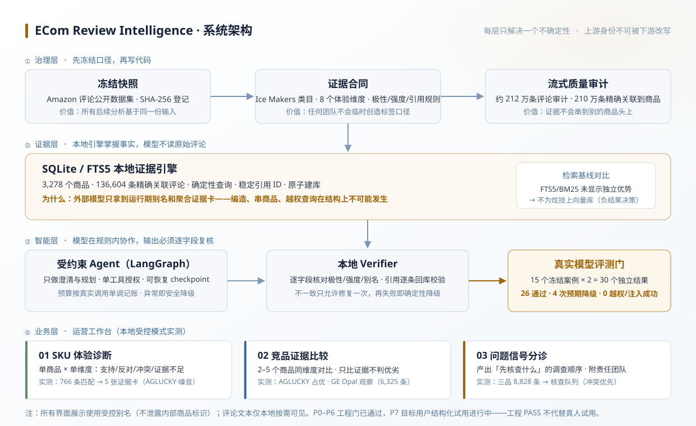

# 电商评论证据 Agent · ECom Review Intelligence

<p align="center">
  
</p>

**把海量商品评论整理成"可回查、可复核"的运营证据，而不是一段无法溯源的总结。**
受约束 Agent + 本地证据引擎 + 逐字段校验——编造、串商品、越权查询在结构上不可能发生。

      

## 一句话读懂

类目运营要回答「这款制冰机的噪音是不是真问题」「和竞品比质量谁占优」「先核查哪个投诉」，得跨几千条评论拼证据。Excel 数得了星级，聊天模型给得出流畅答案，但两者都说不清**结论基于哪几条评论、能不能回查**。本系统把评论整理成**带引用、带方向、带强度、可点开原文复核**的证据卡，并诚实标注"证据不足"。

## 也可以是一个双击就能开的桌面程序

Windows 用户可以直接下载 Release 里的 `EComReviewIntelligence.exe`（40 MB 单文件，内置 3 商品数据子集）：

- 不需要装 Python、不需要命令行、不需要网络、不需要 API key；
- 双击后是一个原生窗口，界面与浏览器版一致；
- checkpoint 与人工核对记录写在 `%LOCALAPPDATA%\EComReviewIntelligence\`；
- 点「AI 深入分析」时仍请你填自己的 key，密钥只留在当前窗口内存里。

源码构建：`powershell -ExecutionPolicy Bypass -File scripts/build_desktop_app.ps1 -OneFile`。
仅 Windows（走系统 WebView2），未做代码签名，可能提示“未知发布者”。

## 界面

`docker compose up --build demo` 起来的页面（合成模式，数据是编的）：


「AI 深入分析」是唯一会把评论原文发给模型的步骤。本站不配置密钥时，页面会请访问者填自己的 key——密钥只存在当前标签页，关闭即清，只为那一次调用使用：


两张图都由 `scripts/capture_workbench_screenshots.cjs` 用真实 Chrome 截取（CDP 驱动，无 playwright 依赖），脚本在保存前会拒绝任何含路径、商品编号或哈希形状的页面文本。

## 为什么可信：三道防编造设计 + 一道评测门

| 设计 | 防什么错 | 怎么做 |
| --- | --- | --- |
| 证据合同（口径先冻结） | 模型或开发者临时创造标签 | Ice Makers 类目、8 个体验维度、极性/强度/引用规则在开发检索与 Agent 之前冻结 |
| 本地证据引擎（SQLite/FTS5） | 编造证据、把别的商品的评论算到当前商品头上 | 约 212 万条评论流式审计、210 万条精确关联到商品；模型只拿运行期别名和聚合证据卡，不读原始评论、不能任意查询 |
| 本地 Verifier（逐字段校验） | 模型改写证据卡的极性和强度 | 引用逐条回库校验；不一致只允许修复一次，再失败即确定性降级——prompt 只是要求，执行控制必须在代码里 |
| 评测门（阻断式） | "假通过" | 30 个冻结案例阻断门 + 真实 DeepSeek 15×2=30 个独立结果：26 通过、4 次预期降级，0 次越权工具 / 注入成功 / 伪造标识 |

## 系统架构



四层各解决一个不确定性：**治理层**冻结口径 → **证据层**让代码而非模型掌握事实 → **智能层**逐字段复核模型输出 → **业务层**把能力变成三个可操作的工作流。每层都先回答"为什么这么做"。

## 三大工作流（本地真实数据实测）

界面上的商品以**受控别名**出现——这是刻意设计：运行时不泄露内部商品标识；评论原文默认私密，点开单卡才按需返回（本地模式）。

| 工作流 | 做什么 | 实测结果 |
| --- | --- | --- |
| 01 SKU 体验诊断 | 单商品 × 单维度：支持/反对/冲突/证据不足四类信号 | "运行噪音"匹配 766 条 → 5 张已校验证据卡 + 人工核查建议 |
| 02 竞品证据比较 | 2–5 个商品同维度对比，只陈述证据方向，不宣布优劣 | AGLUCKY vs GE Profile Opal"制冰质量"6,325 条 → 「A 占优·强 / B 观察·强」 |
| 03 问题信号分诊 | 产出"先核查什么"的调查顺序，附责任团队 | 三款商品 8,828 条 → 核查队列，冲突证据显式标出 |

> 数据对象为 Amazon Reviews 2023 公开数据集中的真实在售制冰机（AGLUCKY / GE Profile Opal / EUHOMY，评论数 4,241 / 4,236 / 3,481）。评论文本与记录级标识不出库。

## 可选的一步：让模型读原文，但不能判"够不够"

证据卡上的「AI 深入分析」是整条链路里唯一会把评论原文发给模型的地方，默认不启用：

- 默认路径不联网、不花钱、没有密钥也能跑完整个流程；没有密钥时按钮直接置灰；
- 点一下 = 读该维度抽样到的 5 条评论原文 + 调用 1 次模型，产出「能说什么 / 具体的点 / 读作无关的评论 / 不能说什么」；
- 模型**不**判断证据够不够。那个问题在实验里没有稳定答案：手写计数规则跨两批人工标注从 0.65 掉到 0.35，模型探针 0.55 / 0.80 且宽松提示词有 37.5% 假阳性。决策记录见 [docs/decisions/phase-7-model-role.md](docs/decisions/phase-7-model-role.md)；
- 四条机器可查的规矩把输出锁住：每条评论都必须有自己的判定、被判相关的必须至少被引用一次、被引用的必须被判为相关、每句引文必须是它自己那条评论的逐字子串。任一条不过就整段丢弃，页面只显示"引用未通过校验"和没通过的原因，可以再点一次；
- 结果按（运行令牌，证据卡）缓存，再点不重复花钱；失败不缓存，所以重试的代价就是再花 1 次。

实测：15 次真实调用 14 次可用（唯一失败是"判为相关却没引用"，重试即通过）。一次稳定失败的卡片（模型把供给的编号 E1–E5 自己改写成 R1–R5），定位后修在提示词层而不是放松校验，修完同一张卡 6/6 通过。

## 人工核对记录：点一下，留一条可导出的证据

运营对每张证据卡可以点「确认 / 存疑 / 驳回」。每次点击都会落盘成一行记录（运行别名、维度、商品、方向、强度、匹配/卡片数、时间），**不含评论原文、不含证据编号、不含路径**：

```powershell
.\.venv\Scripts\python.exe scripts/export_run_verdicts.py --run-token <token> --output review.md
```

导出的是"核对进度 n/m + 每张卡的判定表"，可以直接给不需要看原文的人。判定只能改不能清空：点另一个按钮就是改判，同一张卡始终只有最新一条生效。

## 两个值得讲的工程取舍

- **检索负结果**：冻结案例对比后 FTS5/BM25 没有显示独立优势，项目没有为"技术栈好看"强行上向量库——同时记录该结论的循环偏向边界。技术选型服务于问题，而不是简历。
- **分层评测**：检索、Agent 离线、真实模型、工作台各有独立 Gate 与"能证明什么/不能证明什么"清单——防止一个绿色对勾掩盖所有问题。

## 下载即用（不需要数据集，不需要密钥）

仓库自带 `data/public/ice_makers_public.sqlite`：3 个商品、11,958 条真实评论、10.9 MB。克隆后一条命令：

```powershell
docker compose up --build demo      # http://127.0.0.1:8000
```

不用容器也可以：

```powershell
python -m venv .venv
.\.venv\Scripts\python.exe -m pip install -e ".[dev]"
.\.venv\Scripts\python.exe scripts/serve_demo.py --port 8000 --mode bundled
```

三条工作流、证据卡、人工核对记录开箱可用。只有「AI 深入分析」需要密钥，两种方式都行：部署方设置 `DEEPSEEK_API_KEY`；或者**让访问者自己填**——页面会请他粘贴自己的 DeepSeek key，只存在当前标签页、关闭即清，只为那一次调用使用，不落盘、不进日志、不回显。

## 复现

```powershell
python -m venv .venv
.\.venv\Scripts\python.exe -m pip install -e ".[dev]"
.\.venv\Scripts\python.exe -m pytest                              # 全量测试
.\.venv\Scripts\python.exe scripts/run_phase6_evaluation.py --project-root .   # 30 案例离线门
.\.venv\Scripts\python.exe scripts/run_phase7_workbench.py --port 8765           # 工作台（合成模式）
# 本地受控模式（真实本地数据，需先完成 P4 建库）：
.\.venv\Scripts\python.exe scripts/run_phase7_workbench.py --mode local --acknowledge-local-data --project-root . --port 8765
```

容器（默认合成数据，镜像里不含评论；真实数据用 local profile 挂载本机 `data/`）：

```powershell
docker compose up --build demo                    # http://127.0.0.1:8000
docker compose --profile local up --build local   # http://127.0.0.1:8001
```

三个开关默认全部关闭，需要显式打开：绑非 loopback 要 `--allow-non-loopback`，读真实评论要 `--acknowledge-local-data`，外部域名要加进 `WORKBENCH_ALLOWED_HOSTS`（默认只接受 loopback 的 Host 头，用于挡 DNS rebinding）。细节见 [docs/deployment.md](docs/deployment.md)。

完整工程细节、阶段 Gate 记录与 P6 replay/live 说明见 [docs/engineering-readme.md](docs/engineering-readme.md)、[docs/master-plan.md](docs/master-plan.md) 与 [docs/reports/](docs/reports/)。

## 证据边界（读 result 前必读）

- P0–P6 工程门已通过；P7 目标运营用户的结构化试用**进行中**——工程 PASS 不代替真人试用。
- 不声称已上线、已节省工时或已改善业务指标；评测证明的是有界工程行为，不是生产 SLA。
- 不根据评论推断真实缺陷率、销量或利润；不回答"该买哪个"。
- 仓库自带一份**固定的 3 商品演示子集**（11,958 条真实评论，10.9 MB），用于"下载即可运行"；它是演示样本，不是数据分发通道，仓库里没有批量导出接口，也不会加。完整类目库（165 MB）与原始 gzip 不在仓库中（边界详见 [docs/data-use-and-publication.md](docs/data-use-and-publication.md)）。

## License

代码 MIT。数据集遵其来源条款，评论内容与记录级数据不随仓库分发。
